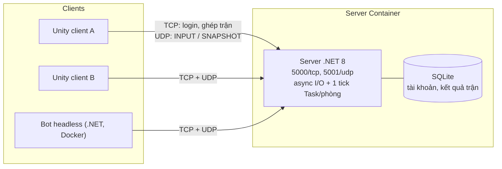

# Project Name

> **Course:** Network Programming (INT1433) · PTIT · Instructor: Dr. Hung N. Dang
>
> Game 2 người "Xếp đơn hàng siêu thị" chơi real-time qua mạng, dùng authoritative server, client-side prediction,
> reconciliation, interpolation và lag compensation để chơi mượt và công bằng ngay cả khi mạng trễ.

👋 **New here? Read first:** [`docs/student-guide.md`](docs/student-guide.md) · 📜 Brief & grading: [`INSTRUCTION.md`](INSTRUCTION.md) · 🚀 Workflow: [`GETTING_STARTED.md`](GETTING_STARTED.md)

> **Template note:** replace every *(italic placeholder)* below. Sections marked **(mandatory)** are required for grading.

---

## 1. Team (mandatory)

| # | Full name           | Student ID | Class | GitHub     | Role                      |
| :-: | ------------------- | :--------: | :---: | ---------- | ------------------------- |
| 1 | Nguyễn Thế Chiến | B23DCCN095 |      | @luulichma | #1 - Server & giao thức (trưởng nhóm); hỗ trợ #3 |
| 2 | Nguyễn Đức Anh | B23DCCN031 |      | @          | #2 - Client netcode (prediction, reconciliation, interpolation) |
| 3 | Phạm Quang Anh | B23DCCN044 |      | @          | #3 - Gameplay, lag compensation, demo & test |

**Topic:** T47 - Real-time Multiplayer Game Networking - Client Prediction

---

## 2. Problem & Idea (mandatory)

- **Problem:** Trong game multiplayer real-time, độ trễ, jitter và mất gói làm điều khiển bị "ì", đối thủ bị giật.
  Bản tham khảo (Nhóm BTL 06) để client tự báo vị trí và server chỉ chuyển tiếp, nên vừa giật vừa dễ gian lận.
- **Our idea:** Giữ gameplay "Xếp đơn hàng siêu thị" (2 người nhặt đúng món khách yêu cầu, mang về quầy, đúng đơn
  +5 điểm, trận 2:30), nhưng làm lại tầng mạng: client chỉ gửi input, server .NET tính toàn bộ trạng thái theo tick.
  Client Unity dùng prediction + reconciliation cho nhân vật của mình và interpolation cho đối thủ; server dùng lag
  compensation để phân xử công bằng khi 2 người tranh cùng một món đồ hiếm.
- **What makes it non-trivial:** Đồng bộ trạng thái real-time qua UDP (mất gói, sai thứ tự, gói trùng) song song với
  TCP cho đăng nhập/ghép trận; nhiều phòng chạy đồng thời, mỗi phòng một vòng tick 30 Hz; mô phỏng tất định dùng
  chung giữa client và server để reconcile không rung; tua lại lịch sử vị trí để phân xử theo đúng cái người chơi thấy.
- **Out of scope:** Bạn bè, thách đấu, lịch sử đấu, reconnect giữa trận; rollback hành động và smoothing chỉ làm nếu
  còn thời gian.

Full proposal: [`docs/proposal.md`](docs/proposal.md)

---

## 3. Features

- [ ] **Connection & session:** *(handshake, authentication, ...)*
- [ ] **Custom protocol:** specified in [`docs/protocol-design.md`](docs/protocol-design.md)
- [ ] **Concurrency:** many clients at once, thread-safe shared state
- [ ] **Robustness:** abrupt disconnects, malformed messages, timeouts
- [ ] **Feature A:** *(short description)*
- [ ] **Feature B:** *(short description)*

---

## 4. Architecture



| Aspect            | Our choice                                   | Why (one line) |
| ----------------- | -------------------------------------------- | -------------- |
| Language          | C# (.NET 8 server, Unity client, thư viện chung netstandard2.1) | Client và server chạy cùng `Simulation.Step`, reconcile không rung |
| Transport         | TCP (login, ghép trận, kết thúc) + UDP (INPUT, SNAPSHOT) | Lệnh quan trọng cần chắc chắn tới; dữ liệu real-time cần trễ thấp, chịu mất gói |
| Framing           | Length-prefix `[u32 len][u8 type][payload]`, tối đa 4096 | Payload nhị phân chứa mọi byte; chặn frame khổng lồ |
| Concurrency model | Async I/O + 1 vòng nhận UDP + 1 vòng tick 30 Hz mỗi phòng | Không client nào chặn client khác; state phòng chỉ một luồng ghi nên không cần lock |

Details: [`docs/architecture.md`](docs/architecture.md)

---

## 5. Quick Start

```bash
cp .env.example .env          # or: make init
docker compose up --build -d  # start the server   (or: make up)
docker compose run --rm client  # start a client — repeat in more terminals (or: make client)
docker compose down           # stop everything    (or: make down)
```

### 5.1 Client Unity (chạy native)

*(#3 bổ sung: phiên bản Unity, cách mở project, nhập HOST / PORT ở màn đăng nhập.)*

### 5.2 Chạy trên 2 máy qua mạng LAN

Máy A chạy server, máy B chỉ chạy client. Hai máy cùng một mạng (nên dùng router riêng / hotspot điện thoại, vì Wi-Fi
công cộng thường chặn các máy nói chuyện với nhau).

1. Máy A: `docker compose up --build -d`.
2. Máy A: lấy IPv4 của card mạng đang dùng.

   ```powershell
   ipconfig
   ```

3. Máy A: mở cổng vào trên Windows Firewall (PowerShell **Run as Administrator**, chỉ làm một lần):

   ```powershell
   netsh advfirewall firewall add rule name="T47 TCP 5000" dir=in action=allow protocol=TCP localport=5000
   netsh advfirewall firewall add rule name="T47 UDP 5001" dir=in action=allow protocol=UDP localport=5001
   ```

4. Máy B: kiểm tra thông cổng TCP (thay bằng IP ở bước 2).

   ```powershell
   Test-NetConnection 192.168.1.10 -Port 5000
   ```

5. Máy B: mở client, nhập `HOST` = IP máy A, `PORT` = `5000`. Máy A mở client với `HOST` = `localhost`.
6. Xong demo, xoá rule firewall nếu muốn:

   ```powershell
   netsh advfirewall firewall delete rule name="T47 TCP 5000"
   netsh advfirewall firewall delete rule name="T47 UDP 5001"
   ```

---

## 6. Demo & Test Evidence

*(Screenshots or terminal output of: several clients at once, abrupt disconnect handling, your concurrency test.
Put images in `docs/asset/`. Full results: [`docs/testing-guide.md`](docs/testing-guide.md).)*

---

## 7. Documentation

| Document                                              | Content                                             |
| ----------------------------------------------------- | --------------------------------------------------- |
| [`docs/proposal.md`](docs/proposal.md)               | M1 — problem, idea, scope, plan                    |
| [`docs/protocol-design.md`](docs/protocol-design.md) | Application-layer protocol specification            |
| [`docs/architecture.md`](docs/architecture.md)       | Concurrency model, components, connection lifecycle |
| [`docs/testing-guide.md`](docs/testing-guide.md)     | Test methods and our test evidence                  |
| [`docs/ai-log.md`](docs/ai-log.md)                   | AI usage log                                        |

---

## 8. AI Disclosure (mandatory)

> Policy: [`INSTRUCTION.md` §7](INSTRUCTION.md#7-ai-usage-policy). Disclosing AI use never lowers your score — hiding it does.

### 8.1 Summary

| Tool / model       | Used by      | Used for                                              | Files / modules | Level                               |
| ------------------ | ------------ | ----------------------------------------------------- | --------------- | ----------------------------------- |
| *(e.g., Claude)* | *(member)* | *(e.g., draft protocol table, review locking code)* | *(paths)*     | *(Assist / Co-write / Generated)* |

**Levels:** **Assist** — explanations, suggestions, review; we wrote the code. **Co-write** — AI drafted parts, we
substantially rewrote. **Generated** — AI wrote most of it; we reviewed, tested and can explain it.

### 8.2 Decisions we made ourselves

*(Key design decisions made by the team, possibly after comparing AI-suggested options. E.g., "Chose length-prefixed
framing over newline-delimited because file chunks may contain `\n`.")*

### 8.3 Where AI was wrong — and how we found out

*(At least one concrete example: a bug, wrong assumption or bad design from AI, and how you detected and fixed it.)*

### 8.4 Full log

See [`docs/ai-log.md`](docs/ai-log.md).

---

## 9. Contribution (mandatory)

| Member | Owns (modules / documents)                                    | Key PRs / commits  | AI-assisted parts                       | Contribution % |
| ------ | ------------------------------------------------------------- | ------------------ | --------------------------------------- | :------------: |
|        | *(e.g., `server/src/session/`, `docs/architecture.md`)* | *(e.g., #3, #7)* | *(e.g., protocol parser — Co-write)* |                |
|        |                                                               |                    |                                         |                |
|        |                                                               |                    |                                         |                |

We confirm the table above is accurate and agreed by all members:

- [ ] Member 1
- [ ] Member 2
- [ ] Member 3

---

<sub>Based on the  template by Hung N. Dang.</sub>
