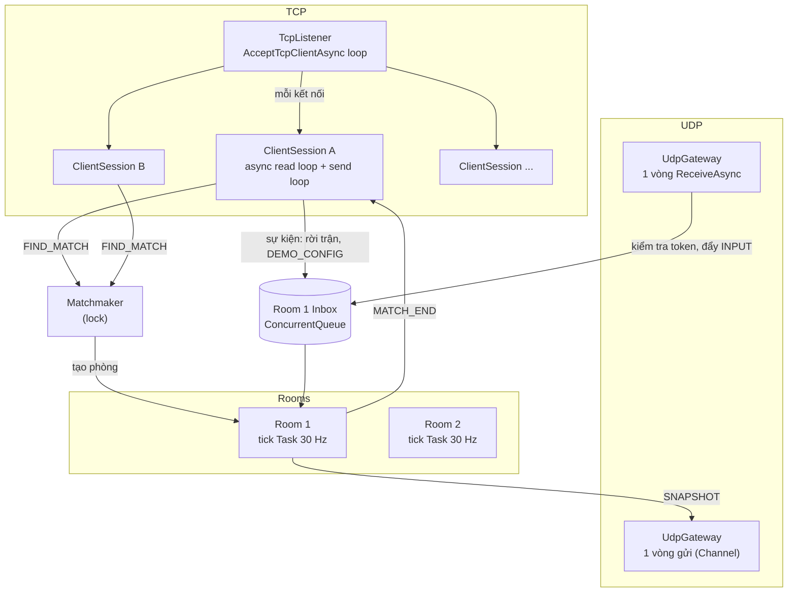
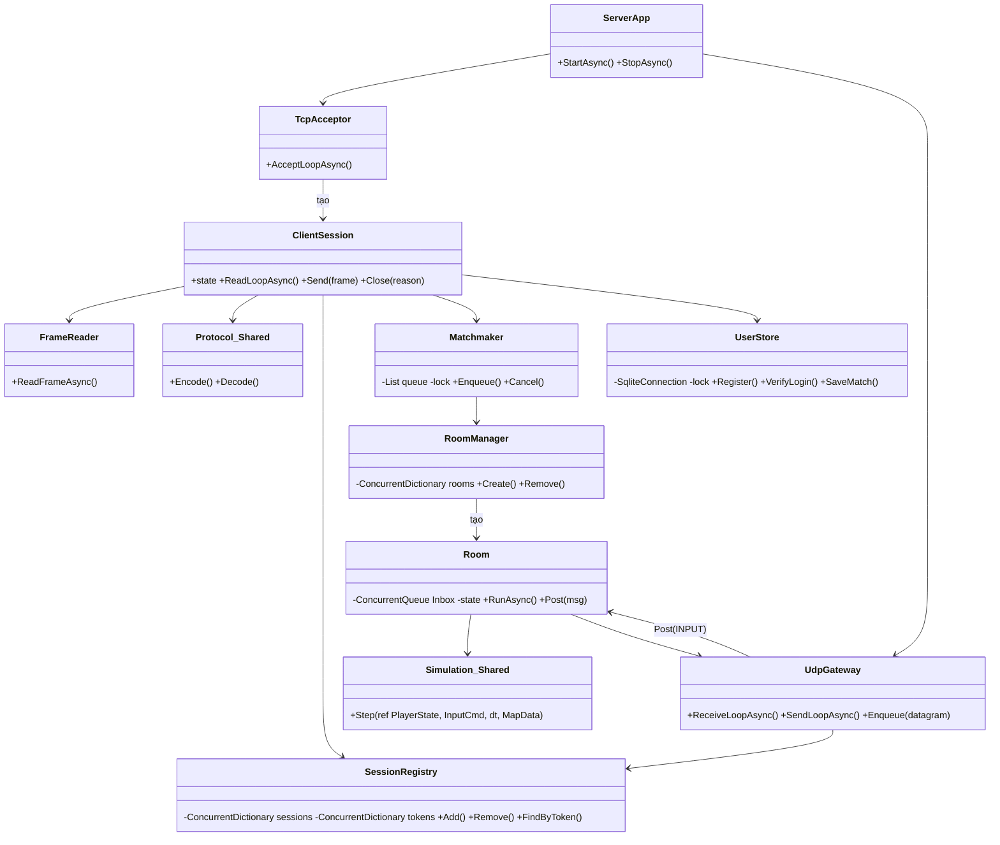
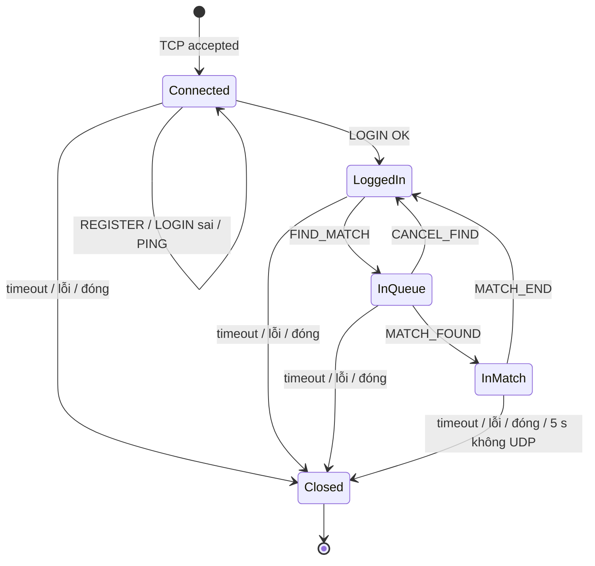
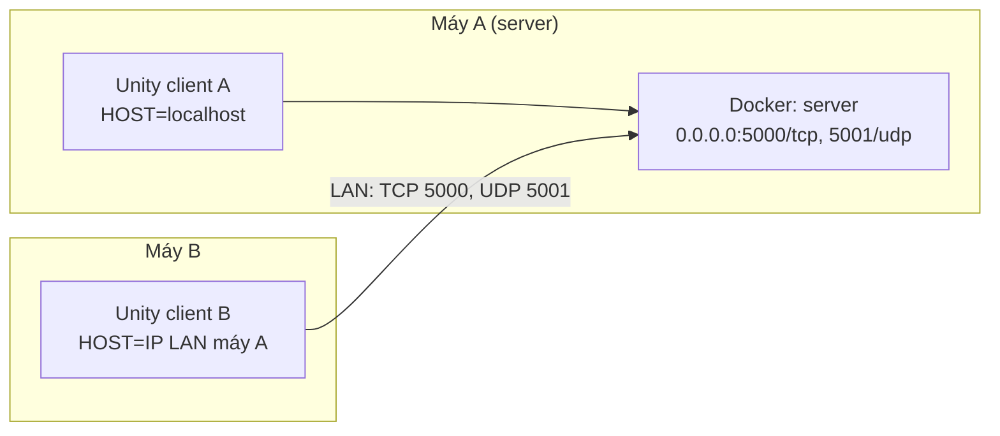

# System Architecture

> Kiến trúc server .NET 8 và cách nó phục vụ nhiều client đồng thời. Chấm theo tiêu chí **A3 - Architecture &
> Concurrency Design**. Giao thức chi tiết: [`protocol-design.md`](protocol-design.md).
> Phần client (prediction, reconciliation, interpolation) do #2 viết ở §7; bộ mô phỏng mạng và lag compensation phía
> gameplay do #3 viết ở §8.

---

## 1. Concurrency Model

**Mô hình của nhóm: async I/O + một vòng nhận UDP + một vòng tick riêng cho mỗi phòng.**



| Thành phần | Chạy trên | Làm gì |
| --- | --- | --- |
| Vòng accept | 1 `Task` async | Nhận kết nối TCP, tạo `ClientSession`, đăng ký vào `SessionRegistry` |
| `ClientSession` | 2 `Task` async mỗi kết nối: đọc và gửi | Đọc frame, kiểm tra trạng thái phiên, dispatch lệnh; vòng gửi lấy frame từ hàng đợi gửi riêng |
| `UdpGateway` (nhận) | 1 `Task` cho cả server | `ReceiveAsync` mọi gói UDP, kiểm tra header + token, đẩy vào Inbox của phòng tương ứng |
| `UdpGateway` (gửi) | 1 `Task` cho cả server | Lấy datagram từ `Channel` và gửi đi, nên chỉ có **một** chỗ gọi socket UDP để gửi |
| `Room` | 1 `Task` mỗi phòng | Vòng tick 30 Hz: rút Inbox, chạy `Simulation.Step`, xử lý nhặt/giao, gửi SNAPSHOT 20 Hz |

**Vì sao chọn mô hình này:**

- **Async I/O** (`await ReadAsync`) không giữ thread khi chờ dữ liệu. 50 client đang chờ không tốn 50 thread; thread pool
  của .NET chỉ dùng vài thread để phục vụ tất cả. Vì vậy không client nào chặn client khác.
- **Mỗi phòng một vòng tick** nên phòng chậm hoặc lỗi không kéo các phòng khác. Vòng tick có `try/catch` bao ngoài: lỗi thì
  ghi log, gửi `MATCH_END` và đóng riêng phòng đó.
- **Chỉ vòng tick được sửa state của phòng.** Mọi luồng khác muốn tác động vào phòng (INPUT, người chơi rời, DEMO_CONFIG)
  đều **gửi tin nhắn vào Inbox** (`ConcurrentQueue`). Nhờ vậy state game (vị trí, đồ, điểm) **không cần lock**, không thể
  có race condition hay deadlock trên state game.

**Phương án đã loại:**

| Phương án | Vì sao không chọn |
| --- | --- |
| Thread-per-client + blocking I/O | Dễ viết, nhưng 1 thread/client tốn bộ nhớ, và state phòng bị nhiều thread client cùng sửa nên phải lock khắp nơi |
| Một game loop chung cho mọi phòng | Đơn giản hơn, nhưng một phòng chậm làm tụt tick của tất cả |
| Event loop đơn luồng | Không tận dụng nhiều nhân CPU; một tác vụ chậm (hash PBKDF2) làm đứng cả server |

**Đánh đổi:** code async khó debug hơn; nhiều phòng = nhiều vòng tick tranh CPU (25 phòng × 30 tick/giây vẫn rất nhẹ).

### 1.1 Vòng tick cố định

```text
dt = 1 / TICK_RATE                      # 1/30 s
next = stopwatch.Elapsed
loop:
    next += dt
    rút hết Inbox → áp dụng input theo seq, sự kiện (rời trận, DEMO_CONFIG)
    Simulation.Step cho từng người; xử lý J/K; tick++
    lưu vị trí vào lịch sử 30 tick (ring buffer)
    nếu tick này đến lượt SNAPSHOT (2 trên 3 tick ≈ 20 Hz) → đẩy vào Channel gửi UDP
    chờ tới `next` (Task.Delay phần còn lại)
    nếu trễ hơn 5 tick → bỏ qua phần trễ, ghi log (không chạy dồn vô hạn)
```

- Thời điểm tick tiếp theo tính từ `Stopwatch` chứ không `Sleep(33)`, nên sai số không cộng dồn.
- Log mỗi 5 giây: số tick thực tế mỗi giây của từng phòng (để chứng minh ≈ 30 khi có tải).

### 1.2 Nếu có 1.000 client thì sao?

- 1.000 kết nối TCP: async I/O chịu được, chủ yếu tốn bộ nhớ đệm mỗi kết nối.
- 500 phòng × 30 tick/giây = 15.000 lần chạy tick/giây trên thread pool. **Nút thắt đầu tiên là CPU** cho vòng tick.
- Đợt đăng nhập dồn dập: mỗi lần PBKDF2 tốn vài chục ms CPU, cộng lock SQLite. Hash được tính **ngoài lock**, chỉ đoạn
  đọc/ghi DB nằm trong lock.
- Gửi UDP qua một `Channel` duy nhất có thể thành hàng chờ dài; khi đó tách thành nhiều socket gửi.
- Con số thật phải đo bằng bot (test tải trong `testing-guide.md`), không đoán.

---

## 2. Components



| Thành phần | Trách nhiệm | Vai phụ trách (theo kế hoạch) |
|-----------|----------------|----------------|
| `TcpAcceptor` | Nhận kết nối TCP, bind `SERVER_HOST:SERVER_PORT` | #1 |
| `ClientSession` | Đọc/ghi một kết nối, ghép frame, máy trạng thái phiên, dispatch lệnh, timeout | #1 |
| `SessionRegistry` | Danh sách phiên đang sống, tra phiên theo token UDP | #1 |
| `Matchmaker` | Hàng đợi tìm trận, ghép 2 người | #1 |
| `RoomManager` / `Room` | Tạo/đóng phòng, vòng tick, SNAPSHOT, MATCH_END, lag compensation | #1 (server), #3 (luật gameplay) |
| `UdpGateway` | Nhận/gửi UDP, kiểm tra header + token, học endpoint | #1 |
| `UserStore` | SQLite: tài khoản (PBKDF2), kết quả trận | #1 |
| `shared/T47.Shared` | Protocol (encode/decode) + `Simulation.Step` dùng chung | #1 (Protocol), #2 (Simulation) |
| Client Unity | Giao diện, prediction, reconciliation, interpolation | #2, #3 |
| Bot headless (`client/`) | Client .NET console để test tải trong Docker | #1, #2 |

### 2.1 Thư viện dùng chung `shared/T47.Shared`

- Class library **netstandard2.1**: server và bot tham chiếu project trực tiếp; Unity dùng file DLL build ra, copy vào
  `client/unity/Assets/Plugins/` bằng script.
- **Vì sao:** prediction + reconciliation chỉ khớp khi client và server chạy **cùng một** `Simulation.Step`. Copy code sang
  2 nơi thì sau vài lần sửa sẽ lệch, nhân vật bị kéo giật khi reconcile. Unity đọc được netstandard2.1, không đọc được net8.0.
- **Phía server / Docker:** build context của `docker compose` là thư mục gốc repo để Dockerfile thấy được `shared/`.
- **Ranh giới với yêu cầu "client và server độc lập":** `shared/` chỉ chứa **đặc tả giao thức dưới dạng code** (mã hoá
  message theo `protocol-design.md`) và luật di chuyển. Client và server vẫn là hai chương trình riêng, chỉ nói chuyện
  qua socket; một client viết bằng ngôn ngữ khác chỉ cần đọc `protocol-design.md` là kết nối được.
- **Đánh đổi:** sửa `shared/` phải build lại DLL cho Unity; không dùng được API riêng của .NET 8 trong `shared/`.

---

## 3. Shared State & Thread Safety

Mọi dữ liệu được hơn một luồng / task truy cập:

| Dữ liệu chung | Ai truy cập | Bảo vệ bằng | Ghi chú |
|--------------|-------------|-----------|-------|
| `SessionRegistry.sessions` (sessionId → phiên) | vòng accept (thêm), mọi `ClientSession` (xoá trong `finally`) | `ConcurrentDictionary` | Chỉ thêm/xoá/tra, không có read-modify-write nhiều bước |
| `SessionRegistry.tokens` (token → người chơi + phòng) | `ClientSession` (thêm khi LOGIN), `Room` (cập nhật khi vào/ra trận), `UdpGateway` (đọc mỗi gói) | `ConcurrentDictionary` | Endpoint UDP lưu trong object người chơi, chỉ `Room` ghi (qua Inbox) |
| Hàng đợi `Matchmaker` | mọi `ClientSession` gọi FIND_MATCH / CANCEL_FIND / ngắt kết nối | `lock (_queueLock)` | **Lấy 2 người ra trong cùng một lock**, nếu không 2 luồng có thể cùng lấy một người và ghép 3 người |
| `RoomManager.rooms` | `Matchmaker` (thêm), `Room` (tự xoá khi đóng), `UdpGateway` (tra) | `ConcurrentDictionary` | |
| `Room.Inbox` | `UdpGateway` + `ClientSession` (ghi), vòng tick của phòng (đọc) | `ConcurrentQueue` | Nhiều nơi ghi, một nơi đọc |
| State trong phòng (vị trí, đồ, điểm, lịch sử 30 tick, chế độ demo) | **chỉ** vòng tick của phòng | Không cần lock | Đúng một luồng đọc và ghi |
| Hàng đợi gửi của mỗi `ClientSession` | chính phiên đó, `Matchmaker` (MATCH_FOUND), `Room` (MATCH_END) | `Channel<byte[]>` + một vòng gửi | Hai luồng không bao giờ ghi xen kẽ byte của 2 frame lên cùng socket |
| `Channel` gửi UDP | mọi `Room` (ghi), vòng gửi UDP (đọc) | `Channel<Datagram>` | |
| `UserStore` (kết nối SQLite) | mọi `ClientSession` (REGISTER/LOGIN), `Room` (lưu kết quả trận) | `lock (_dbLock)`, một kết nối | SQLite không thích ghi đồng thời; PBKDF2 tính **trước** khi vào lock |
| Bộ đếm log (gói rác, số phiên) | nhiều luồng | `Interlocked.Increment` | |

**Vì sao không có deadlock:**

- Không có chỗ nào **giữ hai lock cùng lúc**: `_queueLock` và `_dbLock` không lồng nhau.
- **Không làm I/O mạng khi đang giữ lock.** Ví dụ `Matchmaker` lấy 2 người ra khỏi hàng trong lock, nhả lock rồi mới tạo
  phòng và đẩy `MATCH_FOUND` vào hàng đợi gửi. Một client chậm không thể giữ lock của người khác.
- Giao tiếp với phòng chỉ qua Inbox (không chờ phòng trả lời), nên không có vòng chờ lẫn nhau giữa phiên và phòng.

---

## 4. Connection Lifecycle



### 4.1 Phát hiện từng kiểu kết thúc kết nối

| Kiểu | Server nhận biết thế nào |
| --- | --- |
| Client đóng bình thường | `ReadAsync` trả về 0 byte (nhận FIN) |
| Client chết đột ngột / mạng reset | `IOException` / `SocketException` khi đọc hoặc gửi |
| Client im lặng (treo, rút dây mạng) | Không nhận frame nào trong **15 s** → huỷ `ReadAsync` bằng `CancellationToken` có hẹn giờ |
| Rớt UDP giữa trận | Phòng không nhận gói UDP nào của người đó trong **5 s** |
| Gửi rác | `length` sai → đóng ngay; payload sai 3 lần → đóng |

### 4.2 Dọn dẹp (khối `finally` của `ClientSession`, chạy với mọi kiểu ở trên)

1. Nếu `InQueue`: gỡ khỏi hàng đợi `Matchmaker`.
2. Nếu `InMatch`: đẩy `PlayerLeft` vào Inbox của phòng; phòng xử người đó thua, gửi `MATCH_END(OPPONENT_LEFT)` cho
   người còn lại, lưu kết quả, đóng phòng (§4.3).
3. Gỡ token khỏi `SessionRegistry.tokens`, gỡ phiên khỏi `SessionRegistry.sessions`.
4. Đóng hàng đợi gửi, `Dispose` socket. Ghi log: `session 17 (an) closed: reason=timeout, sessions=42`.

### 4.3 Rớt mạng giữa trận = xử thua ngay

- **Chọn:** rớt (TCP đóng hoặc 5 s không UDP) là thua ngay, không cho kết nối lại.
- **Loại:** giữ chỗ N giây chờ kết nối lại. Phải lưu và khôi phục state, xác thực lại phiên, đồng bộ lại tick; không kịp
  trong thời hạn và dễ sinh lỗi.
- **Vì sao:** đơn giản, chắc chắn đúng, đáp ứng yêu cầu "chịu được ngắt đột ngột". Sockets / task luôn được giải phóng.
- **Đánh đổi:** mạng chập chờn 5 s là mất trận. Kết nối lại nằm trong mục "ngoài phạm vi" của README.

---

## 5. Deployment

### 5.1 Container và cấu hình

| Container | Image / ngôn ngữ | Cổng | Cấu hình (`.env`) |
|-----------|------------------|------|---------------|
| `server` | .NET 8, Dockerfile 2 tầng (`sdk:8.0` build → `runtime:8.0` chạy) | `5000/tcp`, `5001/udp` | `SERVER_HOST=0.0.0.0`, `SERVER_PORT`, `UDP_PORT`, `DB_PATH`, `TICK_RATE`, `DEMO_MODE`, `LOG_LEVEL` |
| `client` (bot) | .NET 8 console, profile `client` | - | `CLIENT_TARGET_HOST=server`, `CLIENT_TARGET_PORT`, số bot |
| Client Unity | chạy native (không trong Docker) | - | `HOST`, `PORT`, `UDP_PORT` nhập ở màn đăng nhập / file cấu hình |

- Server bind `0.0.0.0` trong container, nên nhận được kết nối từ ngoài container (máy host và máy khác trong LAN).
- SQLite nằm trên volume (`./data:/app/data`), dừng container không mất tài khoản.
- `docker-compose.yml` map cả `${SERVER_PORT}:${SERVER_PORT}` và `${UDP_PORT}:${UDP_PORT}/udp`.

### 5.2 Demo trên 2 máy qua LAN



- **Chọn:** demo và vấn đáp chạy trên **2 máy thật** trong cùng mạng LAN.
- **Loại:** chạy hết trên một máy với `localhost`, vì không chứng minh được client và server là hai chương trình độc lập
  chạy qua mạng thật.
- **Vì sao:** chứng minh không hard-code địa chỉ, server bind `0.0.0.0`, và UDP đi qua NAT của Docker vẫn hoạt động (đây
  đúng là lý do server phải học endpoint từ gói thật). LAN chỉ trễ dưới 1 ms, nên vẫn dùng bộ mô phỏng mạng ở client (§8)
  để tạo trễ / mất gói khi trình bày.
- **Rủi ro và cách phòng:**
  - Wi-Fi công cộng có thể chặn các máy nói chuyện với nhau (client isolation) → dùng router riêng / hotspot điện thoại
    hoặc dây LAN.
  - Windows Firewall chặn cổng vào → mở inbound `5000/tcp`, `5001/udp` trên máy A (README §5).
  - IP máy A đổi theo mạng → mỗi lần demo chạy `ipconfig` rồi nhập lại `HOST` ở máy B.
  - Dự phòng: mạng hỏng tại chỗ thì chạy 2 client trên máy A với `localhost` và nói rõ lý do.

---

## 6. Design Decisions

| Quyết định | Phương án đã cân nhắc | Vì sao chọn |
|----------|------------------------|-------------------|
| Async I/O + 1 vòng nhận UDP + 1 vòng tick mỗi phòng | Thread-per-client; một game loop chung; event loop đơn luồng | Không client nào chặn client khác; phòng độc lập; state phòng chỉ một luồng ghi nên không cần lock (§1) |
| Length-prefix, tối đa 4096 | Phân cách `\n` + JSON | Payload nhị phân; chống cấp phát vô hạn (`protocol-design.md` §8.2) |
| Nhị phân tự viết, little-endian | JSON, MessagePack, Protobuf | Gói nhỏ, giải thích được từng byte, không phụ thuộc thư viện trên Unity (`protocol-design.md` §8.3) |
| Session token 4 byte, học endpoint từ UDP_HELLO | Tin endpoint gói đầu; client tự khai cổng | Qua NAT cổng bị đổi; chống người khác gửi input thay (`protocol-design.md` §8.4) |
| `shared/` netstandard2.1 | Copy code sang từng nơi | Client và server chạy cùng `Simulation.Step`, reconcile không rung (§2.1) |
| Bộ mô phỏng mạng chỉ ở client | Ở cả client và server | Mỗi client tự chỉnh độ trễ riêng; server giữ nguyên như chạy thật (§8) |
| Lag compensation theo `viewTick`, tua tối đa 30 tick | `clientTick`; thời điểm server nhận | Phân xử theo cái người chơi thấy; giới hạn lợi thế gian lận (`protocol-design.md` §8.7) |
| Rớt mạng = thua ngay | Giữ chỗ chờ kết nối lại | Đơn giản, chắc chắn đúng, luôn giải phóng tài nguyên (§4.3) |
| PBKDF2-SHA256 100.000 vòng, salt 16 byte | Lưu thô; SHA256 một lần | Lộ DB không lộ mật khẩu (`protocol-design.md` §8.6) |
| Demo 2 máy qua LAN | Một máy `localhost` | Chứng minh chạy qua mạng thật, không hard-code (§5.2) |

---

## 7. Client netcode (do #2 viết)

*(Vòng đời một input: phím bấm → INPUT → Inbox → tick → SNAPSHOT → reconcile; prediction, reconciliation,
interpolation 100 ms.)*

## 8. Bộ mô phỏng mạng và lag compensation phía gameplay (do #3 viết)

*(Bộ mô phỏng mạng: `SimulatedUdp` bọc chiều gửi và nhận, latency hiển thị là RTT. Lag compensation: cơ chế phân xử tranh món hiếm, cách kiểm thử
A = 50 ms, B = 250 ms.)*
