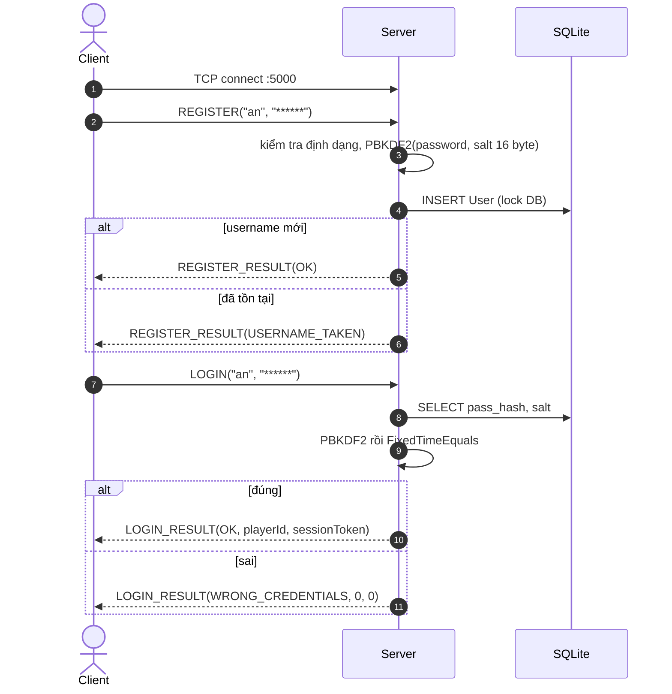
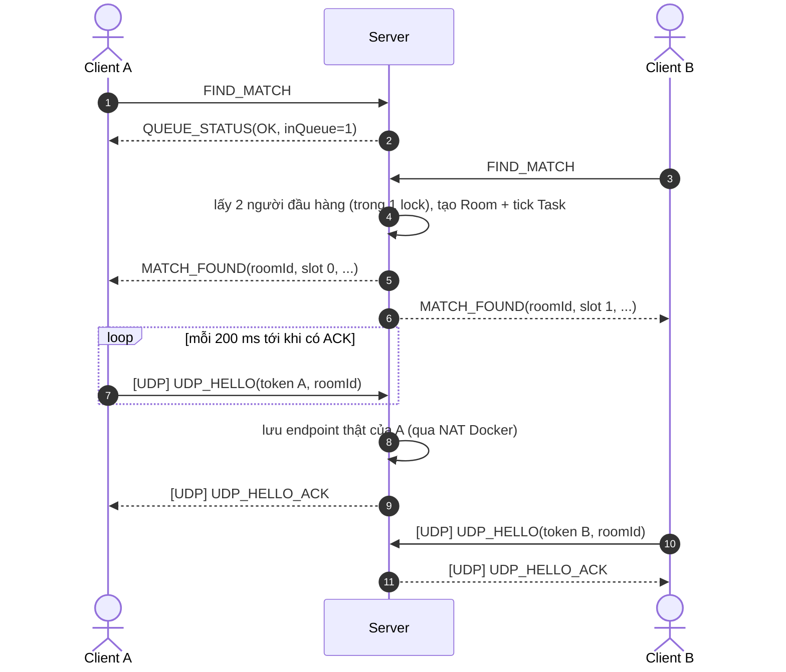
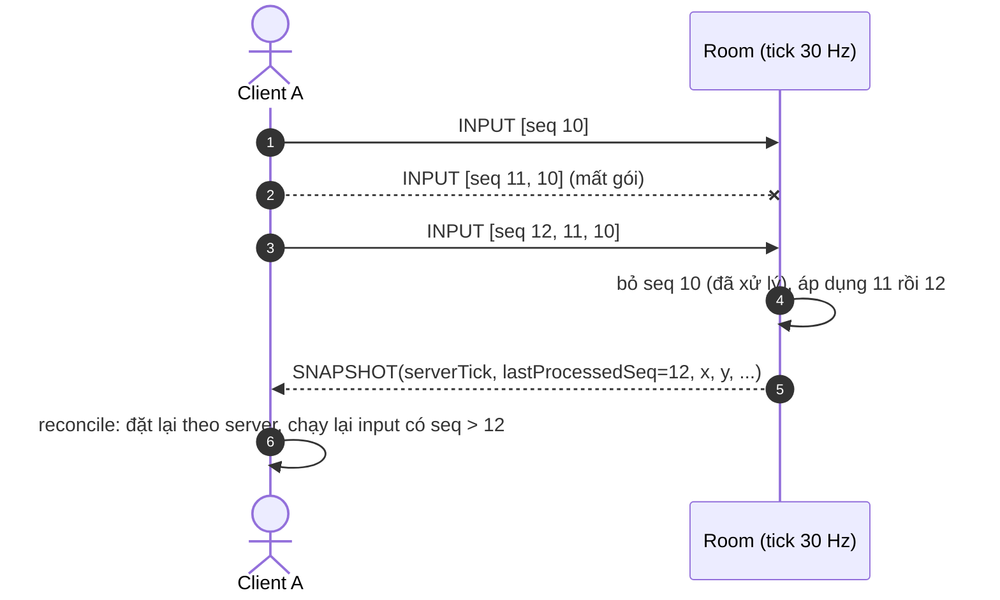
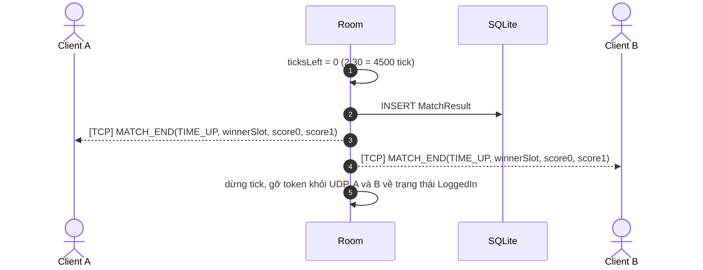
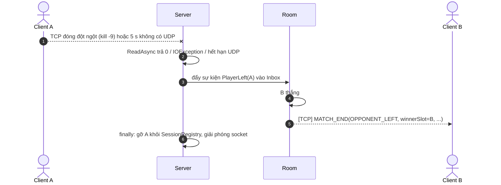
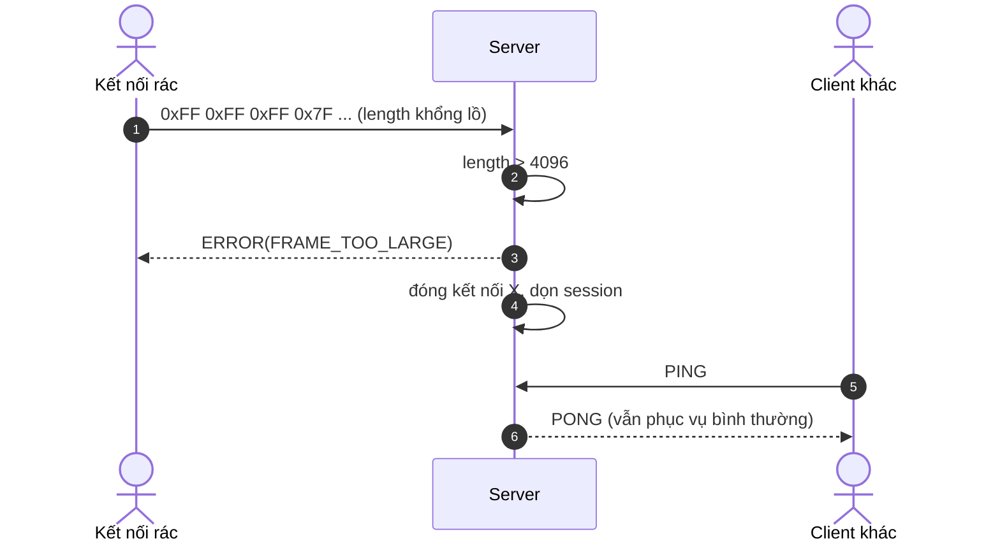

# Application Protocol Specification - T47GP/1

> Đặc tả giao thức tầng ứng dụng giữa client (Unity / bot) và server (.NET 8). Chấm theo tiêu chí **A2 - Protocol Design**.
> Mọi thay đổi message, trường, status code phải sửa file này **trong cùng PR** với code (`shared/T47.Shared/Protocol`).
> Lý do và đánh đổi của từng lựa chọn nằm ở §8.

---

## 1. Overview

| Thuộc tính | Lựa chọn | Vì sao (tóm tắt, chi tiết ở §8) |
|----------|-----------|-----|
| **Tên / phiên bản** | T47 Game Protocol, `T47GP/1` (byte `version = 1` trong header UDP) | Có version để client cũ bị từ chối rõ ràng thay vì đọc sai byte |
| **Transport** | **Cả hai**: TCP cho đăng ký, đăng nhập, ghép trận, kết thúc trận; UDP cho INPUT và SNAPSHOT trong trận | Việc cần chắc chắn tới và đúng thứ tự đi TCP; dữ liệu real-time cần độ trễ thấp và chịu được mất gói đi UDP |
| **Cổng mặc định** | `5000/tcp` (`SERVER_PORT`), `5001/udp` (`UDP_PORT`) | Lấy từ `.env`, không hard-code |
| **Framing TCP** | Length-prefix: `[u32 length][u8 type][payload]`, tối đa 4096 byte | Payload nhị phân có thể chứa mọi byte nên không dùng ký tự phân cách được |
| **Framing UDP** | Mỗi datagram là đúng một message, header cố định 8 byte | UDP vốn giữ ranh giới datagram |
| **Định dạng dữ liệu** | Nhị phân tự viết bằng `BinaryPrimitives`, **little-endian** | Gói nhỏ (INPUT tối đa 61 byte) gửi 30 lần/giây; giải thích được từng byte |
| **Mô hình phiên** | **Stateful**: server nhớ trạng thái của từng kết nối TCP (đã đăng nhập chưa, đang chờ hay đang trong trận) và gắn UDP vào phiên bằng token | Game có trận kéo dài, cần biết ai đang ở phòng nào |
| **Mã hoá ký tự** | UTF-8, chuỗi = `[u16 length][bytes UTF-8]` | |

---

## 2. Message Framing

### 2.1 TCP

TCP là **luồng byte**: một lần gửi có thể tới thành nhiều lần đọc, và nhiều lần gửi có thể tới trong một lần đọc.
Bên nhận dùng `FrameReader` để ghép lại đủ frame:

```text
+------------------+-------------+-------------------------------+
| length (u32, LE) | type (u8)   | payload (length - 1 byte)     |
+------------------+-------------+-------------------------------+
  4 byte             1 byte        0 .. 4095 byte
```

- `length` = số byte của `type + payload` (không tính 4 byte của chính nó).
- Thuật toán đọc: đọc **đủ 4 byte** → kiểm tra `1 <= length <= 4096` → đọc **đủ `length` byte** → giải mã theo `type`.
  "Đọc đủ" nghĩa là lặp `ReadAsync` cho tới khi đủ số byte; `ReadAsync` trả 0 nghĩa là phía bên kia đã đóng kết nối.
- `length = 0` hoặc `length > 4096` → server coi là luồng hỏng: gửi `ERROR(FRAME_TOO_LARGE)` (nếu còn gửi được) và
  **đóng kết nối đó**. Không cố "đồng bộ lại" vì không còn biết frame tiếp theo bắt đầu ở đâu.
- `type` không tồn tại hoặc payload giải mã lỗi (thiếu byte, chuỗi quá dài) → `ERROR(BAD_FRAME)`, giữ kết nối, tăng bộ
  đếm lỗi; **3 lần** lỗi trên một kết nối → đóng. Vì độ dài frame vẫn đúng nên vẫn đọc tiếp được frame sau.

### 2.2 UDP

Mỗi datagram là một message hoàn chỉnh, bắt đầu bằng header 8 byte:

```text
+----------------+-------------+-----------+-------------------+-----------+
| magic (u16 LE) | version(u8) | type (u8) | token (u32, LE)   | payload   |
+----------------+-------------+-----------+-------------------+-----------+
  0x4737 ("G7")    1             xem §4.2    từ LOGIN_RESULT
```

- `magic = 0x4737` giúp loại nhanh gói lạc / rác (trên dây là 2 byte `0x37 0x47` vì little-endian).
- Gói **ngắn hơn 8 byte**, sai `magic`, sai `version`, `token` không thuộc phiên nào, hoặc payload sai độ dài → **bỏ im
  lặng** (không trả lời, để không tạo ra lưu lượng phản xạ), chỉ tăng bộ đếm trong log.
- Kích thước tối đa một datagram: **1200 byte** (dưới MTU thông thường, tránh bị phân mảnh IP).

---

## 3. Message Format

### 3.1 Kiểu dữ liệu

| Ký hiệu | Kích thước | Ghi chú |
| --- | :-: | --- |
| `u8`, `u16`, `u32`, `i16`, `i32` | 1, 2, 4, 2, 4 | Số nguyên, little-endian |
| `f32` | 4 | IEEE 754 single (Unity và .NET giống nhau) |
| `string` | 2 + n | `[u16 n][n byte UTF-8]`, `n <= 64` |
| `T[k]` | | Mảng: trước đó luôn có một trường đếm `u8 k` |

Ví dụ frame `LOGIN` với username `"an"` và password `"abc123"`:

```text
0D 00 00 00 | 03 | 02 00 61 6E | 06 00 61 62 63 31 32 33
length=13     type  "an"          "abc123"
(length = 1 byte type + 4 byte "an" + 8 byte "abc123")
```

### 3.2 Bitmask phím trong INPUT

| Bit | Phím | Ý nghĩa |
| :-: | :-: | --- |
| 0 | W | lên |
| 1 | A | trái |
| 2 | S | xuống |
| 3 | D | phải |
| 4 | J | nhặt / giao hàng |
| 5 | K | thả đồ |
| 6-7 | | dự trữ, phải bằng 0 |

---

## 4. Command Reference

### 4.1 TCP (`[u32 length][u8 type][payload]`)

| Type | Message | Hướng | Payload | Trả lời | Mô tả |
| :-: | --- | :-: | --- | --- | --- |
| `0x01` | `REGISTER` | C → S | `string username, string password` | `REGISTER_RESULT` | Tạo tài khoản |
| `0x02` | `REGISTER_RESULT` | S → C | `u8 status` | | `OK`, `USERNAME_TAKEN`, `INVALID_CREDENTIAL_FORMAT` |
| `0x03` | `LOGIN` | C → S | `string username, string password` | `LOGIN_RESULT` | Đăng nhập |
| `0x04` | `LOGIN_RESULT` | S → C | `u8 status, u32 playerId, u32 sessionToken` | | Token dùng cho mọi gói UDP; = 0 nếu lỗi |
| `0x05` | `FIND_MATCH` | C → S | (trống) | `QUEUE_STATUS` | Vào hàng đợi ghép trận |
| `0x06` | `CANCEL_FIND` | C → S | (trống) | `QUEUE_STATUS` | Rời hàng đợi |
| `0x07` | `QUEUE_STATUS` | S → C | `u8 status, u8 inQueue` | | `inQueue = 1` khi đang chờ |
| `0x08` | `MATCH_FOUND` | S → C | `u32 roomId, u8 yourSlot, u32 opponentId, string opponentName, u16 udpPort, u32 seed, u16 tickRate, u8 k, i16 itemIds[k]` | | Đã ghép xong; client bắt đầu gửi `UDP_HELLO` |
| `0x09` | `MATCH_END` | S → C | `u8 reason, u8 winnerSlot, i32 score0, i32 score1` | | `reason`: 0 `TIME_UP`, 1 `OPPONENT_LEFT`; `winnerSlot = 255` nếu hoà |
| `0x0A` | `PING` | C → S | `u32 nonce` | `PONG` | Giữ kết nối, đo RTT TCP |
| `0x0B` | `PONG` | S → C | `u32 nonce` | | Lặp lại `nonce` |
| `0x0C` | `DEMO_CONFIG` | C → S | `u8 roomMode, u8 lagComp` | `DEMO_CONFIG_RESULT` | `roomMode`: 0 authoritative, 1 relay. Chỉ nhận khi `DEMO_MODE=true` |
| `0x0D` | `DEMO_CONFIG_RESULT` | S → C | `u8 status` | | `OK` hoặc `DEMO_DISABLED` |
| `0x0E` | `ERROR` | S → C | `u8 code, string detail` | | Lỗi không gắn với lệnh nào cụ thể (frame hỏng, sai trạng thái) |

Không có lệnh QUIT riêng: client đóng TCP là thoát. Server xử lý giống mọi kiểu ngắt kết nối (xem `architecture.md` §4).

### 4.2 UDP (header 8 byte + payload)

| Type | Message | Hướng | Payload | Mô tả |
| :-: | --- | :-: | --- | --- |
| `0x41` | `UDP_HELLO` | C → S | `u32 roomId` | Gửi mỗi 200 ms sau `MATCH_FOUND` cho tới khi nhận ACK (tối đa 5 s). Server **học endpoint** (IP:port thật) từ gói này |
| `0x42` | `UDP_HELLO_ACK` | S → C | (trống) | Xác nhận đường UDP hai chiều thông |
| `0x43` | `INPUT` | C → S | `u8 k (1..4)`, rồi `k` lần `{u32 seq, u32 clientTick, u32 viewTick, u8 keys}`, **mới nhất trước** | Mỗi tick client gửi input mới kèm tối đa 3 input cũ chưa được xác nhận, để một gói mất không làm mất bước đi. Tối đa 8 + 1 + 4 × 13 = **61 byte** |
| `0x44` | `SNAPSHOT` | S → C | `u32 serverTick, u16 ticksLeft`, `u8 p` lần `{u32 playerId, u32 lastProcessedSeq, f32 x, f32 y, f32 vx, f32 vy, i16 heldItem, i32 score}`, `u8 m` lần `{i16 itemId, u8 state, u8 holderSlot, f32 x, f32 y}` | Trạng thái do server tính. `heldItem = -1` khi tay rỗng; `state`: 0 trên kệ, 1 trong tay, 2 dưới đất. Gửi 20 lần/giây |
| `0x45` | `ACTION_RESULT` | S → C | `u32 seq, u8 accepted, u8 reason, i16 itemId` | Báo hành động J/K có `seq` này bị từ chối hay được nhận, để client sửa dự đoán |
| `0x46` | `POS_REPORT` | C → S | `u32 seq, f32 x, f32 y` | **Chỉ dùng ở chế độ relay** (baseline so sánh). Ở chế độ authoritative server bỏ qua gói này |

Phần đơn hàng (G2, do #3 làm) sẽ được thêm vào cuối `SNAPSHOT` khi chốt. Thêm trường thì phải sửa bảng này trước.

### 4.3 Quy tắc xử lý INPUT ở server

- Mỗi người chơi có `lastProcessedSeq`. Input có `seq <= lastProcessedSeq` (trùng hoặc đến muộn) → bỏ.
- Input mới được áp dụng **theo thứ tự `seq`**, mỗi input đúng **một lần `Simulation.Step(dt)`**. Client cũng chạy đúng
  hàm này, nên khi reconcile kết quả trùng khớp.
- Một tick xử lý **tối đa 4 input** của một người. Client gửi dồn nhiều input hơn (cố tình đi nhanh) thì phần dư bị bỏ.
- Tick không có input mới của một người → người đó **đứng yên** ở tick đó (không đoán thay client).
- `viewTick`: tick của snapshot mà client đang vẽ (đã trừ interpolation delay). Server **kẹp** về
  `[serverTick - 30, serverTick]` trước khi dùng cho lag compensation.

---

## 5. Status Codes & Errors

Dùng chung cho trường `status` / `code` (kiểu `u8`).

| Code | Tên | Dùng trong | Ý nghĩa |
| :-: | --- | --- | --- |
| 0 | `OK` | mọi `*_RESULT`, `QUEUE_STATUS` | Thành công |
| 1 | `WRONG_CREDENTIALS` | `LOGIN_RESULT` | Sai username hoặc mật khẩu (không nói rõ cái nào sai, để không lộ username có tồn tại) |
| 2 | `USERNAME_TAKEN` | `REGISTER_RESULT` | Username đã có |
| 3 | `INVALID_CREDENTIAL_FORMAT` | `REGISTER_RESULT`, `LOGIN_RESULT` | Username 3-20 ký tự `[A-Za-z0-9_]`, mật khẩu 6-64 byte |
| 4 | `ALREADY_LOGGED_IN` | `LOGIN_RESULT` | Tài khoản đang đăng nhập ở kết nối khác; **từ chối lần đăng nhập sau** |
| 5 | `NOT_LOGGED_IN` | `QUEUE_STATUS`, `ERROR` | Gửi lệnh cần đăng nhập khi chưa đăng nhập |
| 6 | `INVALID_STATE` | `QUEUE_STATUS`, `ERROR` | Lệnh không hợp lệ ở trạng thái hiện tại (vd. `FIND_MATCH` khi đang chờ hoặc đang trong trận) |
| 7 | `DEMO_DISABLED` | `DEMO_CONFIG_RESULT` | Server không chạy với `DEMO_MODE=true` |
| 8 | `BAD_FRAME` | `ERROR` | `type` lạ hoặc payload giải mã lỗi |
| 9 | `FRAME_TOO_LARGE` | `ERROR` | `length = 0` hoặc `> 4096`; kết nối sẽ bị đóng |
| 255 | `INTERNAL_ERROR` | mọi chỗ | Lỗi bất ngờ ở server (đã ghi log) |

`ACTION_RESULT.reason`: 0 `OK`, 1 `TOO_FAR`, 2 `HANDS_FULL`, 3 `ITEM_TAKEN`, 4 `WRONG_ORDER`, 5 `LOST_TO_OPPONENT`
(thua khi tranh món hiếm, có lag compensation).

**Server làm gì khi gặp message hỏng?**

| Tình huống | Hành động |
| --- | --- |
| TCP `length` = 0 hoặc > 4096 | `ERROR(FRAME_TOO_LARGE)` rồi đóng kết nối |
| TCP `type` lạ / payload sai | `ERROR(BAD_FRAME)`, giữ kết nối; lần thứ 3 thì đóng |
| TCP lệnh sai trạng thái | `ERROR(NOT_LOGGED_IN)` hoặc `ERROR(INVALID_STATE)`, giữ kết nối |
| UDP gói hỏng / token sai | Bỏ im lặng, tăng bộ đếm |

---

## 6. Sequence Diagrams

### 6.1 Đăng ký và đăng nhập



### 6.2 Ghép trận và mở đường UDP



### 6.3 Trong trận: INPUT, SNAPSHOT và mất gói



### 6.4 Kết thúc trận bình thường



### 6.5 Bất thường: một người rớt mạng giữa trận



### 6.6 Bất thường: dữ liệu rác trên TCP



---

## 7. Limits, Timeouts & Safety

| Quy tắc | Giá trị | Vì sao |
|------|-----------|-----|
| Frame TCP tối đa | 4096 byte | Chặn `length` khổng lồ làm server cấp phát bộ nhớ lớn; message lớn nhất (MATCH_FOUND) chỉ khoảng 100 byte |
| Datagram UDP tối đa | 1200 byte | Dưới MTU, không bị phân mảnh IP |
| Lỗi frame tối đa | 3 lần / kết nối | Phân biệt client lỗi nhẹ với kết nối rác |
| Idle timeout TCP | 15 s không nhận frame nào | Phát hiện client im lặng / chết mà không gửi FIN |
| Keep-alive | Client gửi `PING` mỗi 5 s khi rảnh | Giữ kết nối sống dưới mức timeout |
| UDP im lặng trong trận | 5 s | Coi là rớt mạng (xem `architecture.md` §4.3) |
| `UDP_HELLO` không tới | 5 s sau `MATCH_FOUND` | Coi là rớt mạng, đóng phòng |
| Input mỗi tick | tối đa 4 / người | Chống "tăng tốc" bằng cách gửi dồn input |
| Lag compensation | tua tối đa 30 tick (1 s) | Giới hạn lợi thế nếu client gửi `viewTick` giả |
| Lệnh cần đăng nhập | mọi lệnh trừ `REGISTER`, `LOGIN`, `PING` | |
| `DEMO_CONFIG` | chỉ khi `DEMO_MODE=true` | Người chơi thật không đổi được luật |
| Số client tối đa | không đặt giới hạn cứng | Đo thực tế bằng test tải (bot) trong `testing-guide.md` |

---

## 8. Design Rationale

### 8.1 Vì sao dùng cả TCP và UDP

- **TCP** cho đăng ký, đăng nhập, ghép trận, `MATCH_END`: các message này **phải tới và đúng thứ tự** (mất `MATCH_FOUND`
  là kẹt trận), gửi ít nên độ trễ không quan trọng.
- **UDP** cho `INPUT` / `SNAPSHOT`: gửi 20-30 lần/giây, **cái mới quan trọng hơn cái cũ**. Với TCP, một gói mất làm mọi
  gói sau phải chờ gửi lại (head-of-line blocking), nhân vật đứng hình hàng trăm ms. Với UDP gói mất thì bỏ qua, gói sau
  đã mang trạng thái mới hơn.
- Mất gói UDP được bù ở tầng ứng dụng: INPUT gửi kèm 3 input cũ chưa được xác nhận; SNAPSHOT là trạng thái đầy đủ nên
  mất một cái không sao.
- **Phương án đã loại:** chỉ TCP (đơn giản nhưng giật khi mất gói, đúng vấn đề đề tài muốn giải quyết); chỉ UDP (phải tự
  làm gửi lại + thứ tự cho đăng nhập, tốn công mà không được gì).
- **Đánh đổi:** phải quản lý 2 kênh và gắn chúng với nhau (§8.4).

### 8.2 Framing length-prefix

- **Chọn:** `[u32 length][u8 type][payload]`, tối đa 4096.
- **Loại:** ký tự phân cách `\n` + JSON, vì payload nhị phân có thể chứa byte `0x0A`.
- **Vì sao:** biết trước phải đọc bao nhiêu byte, không phải quét từng byte; giới hạn 4096 chống cấp phát bộ nhớ vô hạn.
- **Đánh đổi:** không đọc được bằng mắt như JSON; phải viết `FrameReader` xử lý nửa frame / nhiều frame trong một lần đọc.

### 8.3 Định dạng nhị phân tự viết

- **Chọn:** tự mã hoá bằng `BinaryPrimitives`, little-endian, chuỗi `[u16 len][UTF-8]`.
- **Loại:** JSON (to gấp nhiều lần, chậm), MessagePack / Protobuf (thêm thư viện, phải chắc chạy được trên Unity, khó
  giải thích từng byte khi vấn đáp).
- **Vì sao little-endian:** Unity và .NET đều chạy trên máy little-endian, nhưng quan trọng hơn là **ghi rõ một thứ tự cố
  định** và dùng `BinaryPrimitives.*LittleEndian` ở cả 2 phía, nên không phụ thuộc máy.
- **Đánh đổi:** encoder và decoder dễ lệch nhau → mọi message đều có unit test encode → decode; thêm trường phải sửa cả
  2 phía và file này cùng lúc.

### 8.4 Gắn gói UDP với người chơi bằng session token

- **Chọn:** `LOGIN_RESULT` trả `sessionToken` ngẫu nhiên 4 byte (`RandomNumberGenerator`); mọi gói UDP mang token trong
  header; endpoint (IP:port) học từ gói `UDP_HELLO` thật; endpoint đổi mà token đúng thì cập nhật.
- **Loại:** tin `IPEndPoint` của gói đầu tiên (ai gửi trước từ cổng đó là chiếm được người chơi), hoặc để client tự khai
  cổng UDP (sai khi đi qua NAT của Docker / router, vì cổng nguồn bị đổi).
- **Đánh đổi:** tốn 4 byte mỗi gói; token không mã hoá nên bị nghe lén trên cùng mạng vẫn lộ. Đủ cho phạm vi đề tài
  (không làm TLS / DTLS).

### 8.5 Stateful

- **Chọn:** server giữ trạng thái mỗi kết nối: `Connected → LoggedIn → InQueue → InMatch → LoggedIn`. Mỗi lệnh được
  kiểm tra theo trạng thái (vd. `FIND_MATCH` khi `InMatch` → `INVALID_STATE`).
- **Loại:** stateless (mỗi request tự mang đủ thông tin như HTTP + token), không hợp với trận đấu dài, server phải biết
  ai đang ở phòng nào để gửi `SNAPSHOT`.
- **Đánh đổi:** server phải dọn trạng thái cẩn thận khi kết nối chết (xem `architecture.md` §4); trạng thái nằm trong RAM
  nên khởi động lại server là mất các trận đang chơi (tài khoản và kết quả trận vẫn còn trong SQLite).

### 8.6 Mật khẩu

- **Chọn:** `Rfc2898DeriveBytes.Pbkdf2(password, salt, 100_000, HashAlgorithmName.SHA256, 32)`, salt 16 byte ngẫu nhiên
  mỗi user, so sánh bằng `CryptographicOperations.FixedTimeEquals`.
- **Loại:** lưu thô (lộ DB là lộ hết); SHA256 một lần (quá nhanh, dò được hàng tỷ mật khẩu mỗi giây).
- **Vì sao:** salt làm 2 người cùng mật khẩu có hash khác nhau và vô hiệu bảng tra sẵn; 100.000 vòng làm mỗi lần thử tốn
  vài chục ms; so sánh thời gian cố định không lộ thông tin qua thời gian phản hồi. Có sẵn trong .NET.
- **Đánh đổi:** mỗi lần đăng nhập tốn CPU (tính hash **ngoài** lock DB để không chặn người khác). Mật khẩu vẫn đi trên
  TCP không mã hoá - giới hạn đã biết của đề tài.

### 8.7 `viewTick` cho lag compensation

- **Chọn:** INPUT mang `viewTick` = tick của snapshot client đang vẽ. Khi 2 người tranh một món, server tua lịch sử vị trí
  về `viewTick` của từng người (kẹp tối đa 30 tick) để xem ai chạm món trước **theo cái họ thấy**.
- **Loại:** dùng `clientTick` (là thời điểm client gửi, không phải cái client nhìn thấy) hoặc thời điểm server nhận (người
  mạng chậm luôn thua).
- **Đánh đổi:** người mạng tốt đôi khi "tới trước trên màn hình mình mà vẫn thua"; server tốn bộ nhớ lịch sử (30 tick ×
  2 người, rất nhỏ).

---

## 9. Mở rộng giao thức (chuẩn bị live change)

Thêm một message TCP mới (vd. `CHAT`) cần sửa đúng các chỗ sau:

1. `shared/T47.Shared/Protocol/MessageType.cs`: thêm giá trị `type` mới (không dùng lại số cũ).
2. `shared/T47.Shared/Protocol/`: thêm hàm encode / decode payload.
3. Server: thêm nhánh xử lý trong bộ dispatch của `ClientSession`, kiểm tra trạng thái phiên.
4. Client: gửi / nhận message mới.
5. Unit test encode → decode.
6. File này: §4 bảng lệnh, §5 nếu có status code mới, §6 nếu có luồng mới.

Đổi kích thước frame tối đa: sửa hằng `MaxFrameLength` trong `shared/` (dùng chung cho client và server) và bảng §7.
